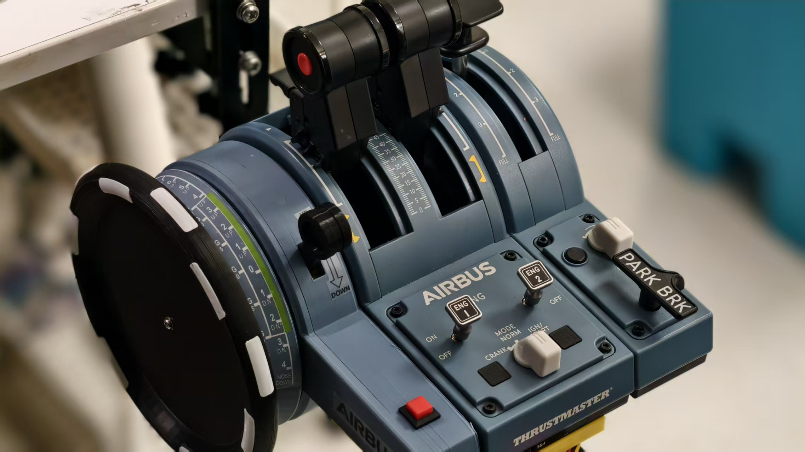

# TCA A320 FOC 电动配平轮项目 (TCA-TrimWheel-FOC)

### 💡 项目起因

去年 618，我入手了图马思特的 TCA 空客摇杆与节流阀套装，正式推开了《微软模拟飞行》的大门。在随后的飞行中，我逐渐迷上了配平轮这个不起眼的设备——虽然在空客的飞行逻辑中我们不常去手动拨动它，但看着它随着飞机姿态的改变而在一旁默默转动，那种实打实的物理反馈，会让你真切地感受到自己正在驾驶一架庞大的钢铁巨兽。

市面上虽然已经有了很多优秀的飞行外设，但带有自动同步功能的配平轮多属于高端进阶设备，对于预算有限的我来说确实是一笔不小的开销。而入门价位段的模块，受限于定价，很难提供真实的物理阻尼感。

既然我手里已经有了 TCA 节流阀，就萌生了给它量身定制一个“外挂电动配平轮”的想法。既然找不到满意的，那就自己动手！结合 FOC 无刷电机技术与 MSFS 游戏的底层数据，经过几个月的反复打磨、PID 调参和程序重构，这套能够随游戏自动同步旋转、且带有真实物理阻尼感的模块终于诞生了。现在，我将它分享出来。

### 📦 开源与分享内容

为了让喜欢折腾的飞友能以较低的成本体验到这款设备，本项目无偿公开以下资料：

1.  **全套 3D 打印件模型（STL 文件）**：包含主轴、齿轮、控制盒等所有结构件。
2.  **Windows 上位机程序**：提供了打包好的便捷版 `.exe`，同时**完全公开对应的 Python 源代码**。代码逻辑清晰透明，大家无需担心任何杀毒软件的误报或后台安全问题。
3.  **硬件 BOM 采购清单**：型号、规格已全部列明，支持大家自行全网采购。

**QQ讨论群:**
1097595222(入群答案:来福是只流浪猫)

**组装教程视频:** [点击进入视频](https://www.bilibili.com/video/BV1P8SXB7EfR/)

### 🔒 关于固件闭源的说明

关于 Arduino 主板的控制程序，我目前仅提供编译好的 `.hex` 刷机文件。
底层的 C++ 代码包含了大量针对 FOC 电机驱动和力反馈手感的参数调优，这是整个项目最核心、耗时最长的心血。为了防止核心逻辑被轻易挪用并被他人包装成廉价商业品，我选择了保留源码。在这里坦白讲，里面的代码逻辑或许并不高明，我自己摸索调出来的配平手感，在某些真正的大佬眼里可能也不值一提。之所以不直接公开这部分底层源码，完全是出于一点个人的防御心理：我不希望自己踩了无数坑、花了所有业余时间一点点试错写出来的逻辑，被部分别有用心的人“毫不费力地全盘拿走”，几乎零成本地变成他们闲鱼或淘宝上的赚钱工具，而作为原作者的我只能无奈地干看着。提供 `.hex` 文件依然能让大家通过工具一键无脑刷机，希望各位飞友能够理解。

### ⚖️ 版权与商业化控制

本项目基于个人对模拟飞行的热爱而诞生，**所有公开的资料仅供飞友个人学习、DIY 制作和非盈利性交流使用。**

未经我本人的书面授权，**严禁将本项目的任何部分用于其他任何商业行为**。

若发现侵权倒卖行为，我将保留追究其责任并停止后续所有更新的权利。

### 🤝 支持与赞助 (Support)

开源和用爱发电固然美好，但一个硬件项目的持续维护与升级（如适配未来新版本的 MSFS、优化结构、研发新模块等）需要实打实的资金和精力投入。

如果您喜欢这个项目，可以通过以下两种方式支持我：

**1. 购买完整硬件套件包**
为了减少大家全网采购的时间和精力，我为大家准备了**完整配件包**(含全套 3D 打印件的到手即可组装套件)，可以在我的闲鱼中找到。
  * 套件内的主板均已为您刷好最新的固件并完成基础通讯测试。
  * *👉 获取方式：在闲鱼搜索"来福是只流浪猫" 查看详细购买途径。*

**2. 通过捐赠支持项目的发展**
如果您完全依靠自己采购并成功组装了这套设备，且它为您带来了不错的飞行体验，并希望它能够持续更新和完善，欢迎通过微信扫码捐赠来支持我的工作和本项目。

**您的每一份支持，都将直接用于本项目硬件模块的持续优化与下一代的研发迭代！**

感谢您的认可与支持！

-----

**⚠️ 免责申明**：DIY 涉及电路连接与机械组装，有一定的损坏风险。本项目及相关文档仅作为经验分享，作者不对任何人因模仿制作带来的电脑损坏、硬件烧毁承担连带责任。动手前请务必确认自己具备一定的基础。

祝大家起落安妥！
—— [macode]

